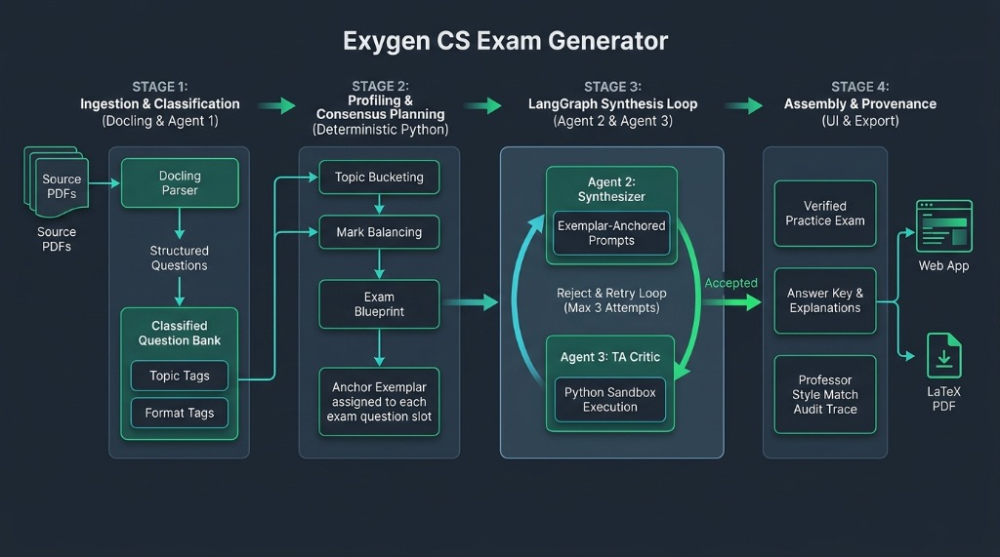
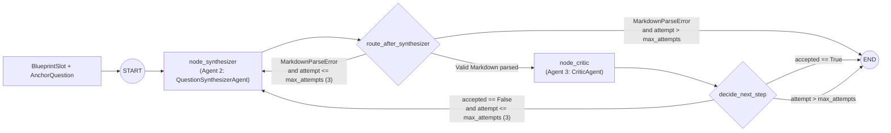

# Exygen Agent (`apps/agent`)

Python package implementing the Exygen multi-agent pipeline, OpenRouter LLM integration, and the Stage 3 LangGraph synthesis & critique loop.



---

## 1. Architecture Overview

Exygen operates in 4 stages across the pipeline:

1. **Stage 1 — Ingestion & Classification (Docling & Agent 1)**: Parses source PDFs into structured `AnchorQuestion` records tagged with topic, format, marks, keywords, archetype, and difficulty.
2. **Stage 2 — Profiling & Consensus Planning (Deterministic Python)**: Balances topics and marks to produce an `ExamBlueprintWithSlots`, where each `BlueprintSlot` is paired with an exemplar `anchor_question_id`.
3. **Stage 3 — LangGraph Synthesis Loop (Agent 2 & Agent 3)**: Iterates slot-by-slot (1 question per cycle). Agent 2 (`QuestionSynthesizerAgent`) synthesizes an original question anchored to the exemplar; Agent 3 (`CriticAgent`) verifies correctness, solvability, and style alignment. Rejected or malformed drafts loop back to Agent 2 with working-memory feedback for up to `max_attempts = 3`.
4. **Stage 4 — Assembly & Provenance (UI & Export)**: Packages the verified questions, answer keys/explanations, and professor style alignment audit trace for the web studio and PDF/Markdown export.

### Stage 3 LangGraph State Machine



---

## 2. Python Module Reference (`src/exygen_agent/`)

| File | Responsibility | Key Classes & Functions |
| :--- | :--- | :--- |
| [`synthesis_contracts.py`](./src/exygen_agent/synthesis_contracts.py) | Typed Pydantic v2 schemas for Stage 1–3 boundaries and Markdown section extraction | `AnchorQuestion`, `BlueprintSlot`, `ExamBlueprintWithSlots`, `SynthesizedQuestion`, `CriticEvaluation`, `CriticFeedback`, `MarkdownParseError`, `extract_markdown_sections()` |
| [`llm_client.py`](./src/exygen_agent/llm_client.py) | OpenRouter LLM client (via OpenAI SDK, configured from `settings.py`) and deterministic mock fallback | `BaseLLMClient`, `OpenRouterClient`, `MockLLMClient`, `get_llm_client()` |
| [`settings.py`](./src/exygen_agent/settings.py) | Typed environment configuration (`APP_*`, `AGENT_*`, `LANGFUSE_*`) loaded from the process environment and `apps/agent/.env`; see [`.env.sample`](./.env.sample) | `Settings`, `AgentSettings`, `LangfuseSettings`, `get_settings()`, `settings` |
| [`synthesizer.py`](./src/exygen_agent/synthesizer.py) | **Agent 2 (Question Synthesizer)**: Exemplar-anchored prompt builder and Markdown-to-object parser | `QuestionSynthesizerAgent`, `build_synthesis_prompt()`, `parse_synthesized_markdown()` |
| [`critic.py`](./src/exygen_agent/critic.py) | **Agent 3 (Critic Interface)**: Academic verification prompt builder and flexible verdict parser | `CriticAgent`, `build_critic_prompt()`, `parse_critic_markdown()` |
| [`synthesis_graph.py`](./src/exygen_agent/synthesis_graph.py) | **LangGraph State Machine**: Slot-by-slot retry orchestration and working-memory feedback injection | `SlotSynthesisState`, `create_slot_synthesis_graph()`, `run_slot_synthesis()`, `synthesize_exam_slots()` |
| [`contracts.py`](./src/exygen_agent/contracts.py) | General pipeline contracts consumed by `apps/api` | `SourceDocument`, `ExtractedExam`, `StyleProfile`, `ExamBlueprint`, `GeneratedQuestion`, `ValidationReport`, `AssembledExam` |
| [`orchestrator.py`](./src/exygen_agent/orchestrator.py) | High-level pipeline coordinator and offline synthetic fixtures | `ExamPipelineOrchestrator`, `default_synthetic_documents()` |

---

## 3. Markdown Section Conventions (Agent 2 & Agent 3)

To prevent code indentation and LaTeX math (such as `$O(n \log n)$`) from breaking JSON escaping, both Agent 2 and Agent 3 exchange structured Markdown sections that are validated and parsed into Pydantic models.

### Agent 2 (`synthesizer.py`) Output Format

- **`## QUESTION`** *(Mandatory)*: Complete question prompt, code snippets, or mathematical setup.
- **`## OPTIONS`** *(Mandatory when `format == "multiple_choice"`; Optional/omitted for all other formats)*:
  Must contain **all 4 choices `(A)`, `(B)`, `(C)`, `(D)`** when `format == "multiple_choice"`. Multi-line option bodies (e.g., code blocks or matrices) are preserved across lines until the next option label.
- **`## SOLUTION`** *(Mandatory)*: For `multiple_choice`, must be one of `A`, `B`, `C`, or `D`. For other formats, the complete solution code or derivation.
- **`## EXPLANATION`** *(Mandatory)*: Step-by-step derivation, state trace, or proof.
- **`## RATIONALE`** *(Mandatory)*: Pedagogical alignment explanation linking the question to the anchor exemplar.
- **`## CODE_TEST_CASES`** *(Optional)*: Python `assert` statements for `code_writing` questions.

> If Agent 2 omits any mandatory section (or provides fewer than 4 options for an MCQ), `parse_synthesized_markdown()` raises `MarkdownParseError`. The LangGraph state machine catches this in `node_synthesizer`, **skips Agent 3**, records a `FORMAT ERROR` in `feedback_history`, and immediately reprompts Agent 2.

### Agent 3 (`critic.py`) Output Format

- **`## ACCEPTED`** *(Mandatory)*: Boolean verdict (`true`/`false`, flexibly parsed across `**True**`, `Yes, accepted`, `false`, `No - rejected`, etc.).
- **`## CORRECTNESS_STATUS`** *(Optional, defaults based on `ACCEPTED`)*: `verified`, `flagged`, or `unverified`.
- **`## CODE_SANDBOX_PASSED`** *(Optional)*: `true` or `false` for `code_writing` questions; `N/A` (parsed as `None`) when not applicable.
- **`## STYLE_ALIGNMENT_SCORE`** *(Optional)*: Float in `[0.0, 1.0]`.
- **`## ISSUES`** *(Optional)*: Bullet list of defects or `None`.
- **`## VERIFIER_NOTES`** *(Mandatory)*: Detailed critique injected into Agent 2's working memory if the question is rejected.

---

## 4. Running Tests & Linting

From the repository root:

```powershell
# Run all unit and integration tests in apps/agent/tests/
.\.venv\Scripts\pytest.exe apps/agent/tests

# Run Ruff linter
.\.venv\Scripts\ruff.exe check apps/agent
```

Test suites:
- [`tests/test_synthesizer.py`](./tests/test_synthesizer.py): Unit tests for Agent 2 prompt building, multi-line MCQ parsing, non-MCQ optional headers, and `MarkdownParseError` enforcement.
- [`tests/test_critic.py`](./tests/test_critic.py): Unit tests for Agent 3 flexible boolean parsing, `N/A` sandbox handling, and mandatory header validation.
- [`tests/test_synthesis_graph.py`](./tests/test_synthesis_graph.py): End-to-end LangGraph tests covering single-attempt pass, Critic rejection retry loop, Synthesizer format-error reprompting (skipping Critic), max-attempts exhaustion, and batch slot synthesis.
