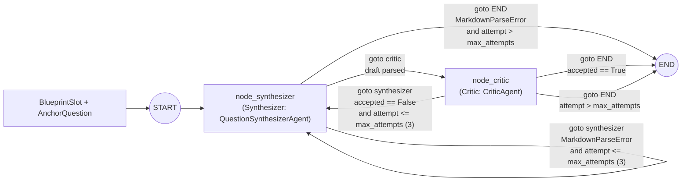

# Synthesis Graph

## Summary

**Stage 3: LangGraph Synthesis Loop (Synthesizer & Critic).** The state machine in `synthesis_graph.py` iterates slot by slot, one question per cycle. It runs [the Synthesizer](synthesizer.md) to draft a question and [the Critic](critic.md) to verify it. Rejected or malformed drafts loop back to the Synthesizer with working-memory feedback for up to `max_attempts = 3`.

The agents communicate only through LangGraph `Command`. Each node returns its state update and the next node in one object, so the graph has no conditional edges.

| Item | Detail |
| --- | --- |
| Key classes and functions | `SlotSynthesisState`, `create_slot_synthesis_graph()`, `run_slot_synthesis()`, `synthesize_exam_slots()` |
| Input | A `BlueprintSlot` and its `AnchorQuestion` |
| Retry limit | `max_attempts = 3` |
| Feedback | Working-memory feedback injected into the Synthesizer on each retry |
| Handoff mechanism | `langgraph.types.Command(update=..., goto=...)` returned by each node |

## State Machine

## Agent Handoffs

Handoffs follow the `Command` primitive described in the LangGraph [Graph API](https://docs.langchain.com/oss/python/langgraph/graph-api#command) reference and the [multi-agent collaboration](https://github.com/langchain-ai/langgraph/blob/23961cff61a42b52525f3b20b4094d8d2fba1744/docs/docs/tutorials/multi_agent/multi-agent-collaboration.ipynb) tutorial. The rules for this repository are:

1. A node that hands work to another agent returns `Command(update={...}, goto="<node>")`. The update carries the new state and `goto` names the node that runs next.
2. Every node annotates its return type with the nodes it can reach, for example `Command[Literal["critic", "synthesizer", "__end__"]]`. LangGraph uses the annotation to draw the graph.
3. The only static edge is `START` to `synthesizer`. A node that returns `Command` must not also have static or conditional edges, because LangGraph runs both paths.
4. A loop ends with `goto=END`. Retry limits are checked inside the node that decides, by incrementing `attempt` in the update and comparing it with `max_attempts`.
5. Agents share data only through `SlotSynthesisState` keys. They never call each other directly.

| Node | Reaches | Update keys |
| --- | --- | --- |
| `node_synthesizer` | `critic`, `synthesizer`, `END` | `current_question`, and on a format error `current_evaluation`, `feedback_history`, `attempt`, plus `final_question` and `final_evaluation` once attempts run out |
| `node_critic` | `synthesizer`, `END` | `current_evaluation`, `final_question`, `feedback_history`, `attempt`, and `final_evaluation` when the draft is accepted or attempts run out |

`graph=Command.PARENT`, which hands control from a subgraph to its parent, is not used yet. The Classifier and Assembly stages are not graph nodes yet, so this loop is the only compiled graph. When it is mounted inside a larger graph, `Command.PARENT` handoffs will need a reducer in the parent for every state key they share.

## Node Behavior

| Node | Behavior |
| --- | --- |
| `node_synthesizer` | Runs the Synthesizer. On success it hands the draft to `critic`. On `MarkdownParseError` it records a `FORMAT ERROR` in `feedback_history`, skips the Critic, and either retries `synthesizer` or ends once `attempt > max_attempts` with a flagged placeholder question |
| `node_critic` | Runs the Critic on the parsed draft. An accepted draft ends the loop. A rejected draft is added to `feedback_history`, then the loop retries `synthesizer` or ends once `attempt > max_attempts` with the last draft flagged |

## Test Coverage

`tests/test_synthesis_graph.py` covers the single-attempt pass, the Critic rejection retry loop, Synthesizer format-error reprompting (skipping the Critic), max-attempts exhaustion, and batch slot synthesis. See [Testing](../testing.md).
