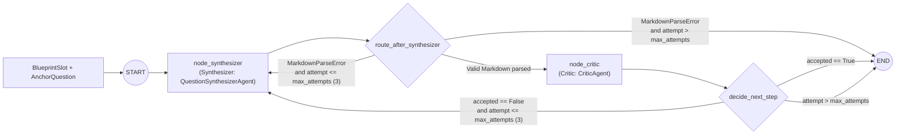

# Synthesis Graph

## Summary

**Stage 3: LangGraph Synthesis Loop (Synthesizer & Critic).** The state machine in `synthesis_graph.py` iterates slot by slot, one question per cycle. It runs [the Synthesizer](synthesizer.md) to draft a question and [the Critic](critic.md) to verify it. Rejected or malformed drafts loop back to the Synthesizer with working-memory feedback for up to `max_attempts = 3`.

| Item | Detail |
| --- | --- |
| Key classes and functions | `SlotSynthesisState`, `create_slot_synthesis_graph()`, `run_slot_synthesis()`, `synthesize_exam_slots()` |
| Input | A `BlueprintSlot` and its `AnchorQuestion` |
| Retry limit | `max_attempts = 3` |
| Feedback | Working-memory feedback injected into the Synthesizer on each retry |

## State Machine

## Routing

| Node or router | Behavior |
| --- | --- |
| `node_synthesizer` | Runs the Synthesizer. On `MarkdownParseError`, records a `FORMAT ERROR` in `feedback_history` and skips the Critic |
| `route_after_synthesizer` | Sends valid Markdown to `node_critic`. Sends a parse error back to `node_synthesizer` while `attempt <= max_attempts`, otherwise ends |
| `node_critic` | Runs the Critic on the parsed draft |
| `decide_next_step` | Ends when `accepted == True`. Loops to `node_synthesizer` when `accepted == False` and `attempt <= max_attempts`. Ends when `attempt > max_attempts` |

## Test Coverage

`tests/test_synthesis_graph.py` covers the single-attempt pass, the Critic rejection retry loop, Synthesizer format-error reprompting (skipping the Critic), max-attempts exhaustion, and batch slot synthesis. See [Testing](../testing.md).
