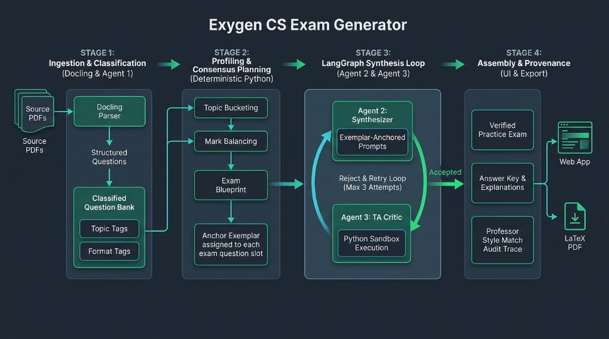

# Agent

## Summary

`apps/agent` (package `exygen-agent`) is the Python package that implements the Exygen multi-agent pipeline. A single LangGraph graph, `exygen`, takes one exam from a source file to reviewed questions through the Classifier, Planner, Synthesizer, and Critic. The package also holds the shared Pydantic data contracts and a deterministic fallback, so the offline demo runs without external model credentials.



## Pages

The docs for this package are split into two pages:

| Page | Covers |
| --- | --- |
| [Pipeline](pipeline.md) | The stages of the Exygen graph, their inputs and outputs, retry behavior, known limits, and what is implemented |
| [Reference](reference.md) | Python modules, contracts, the LLM client, external clients, tracing, settings, the command line, the orchestrator, and tests |

!!! note "Two pipelines in the code"
    The [Architecture](../architecture.md#pipeline) page lists the blueprint's six logical roles. The [Orchestrator](reference.md#orchestrator) runs those roles with deterministic agents, and the offline demo uses it. The [Exygen Graph](pipeline.md#the-exygen-graph) is the LLM-backed pipeline, and `python -m src run` uses it. Its first three stages have working code, and the final assembly stage does not exist yet. The two pipelines share no code path.

## Code Execution Sandbox

`CodeSandboxAgent` (`agents/code_sandbox_agent.py`) runs between the synthesizer and the critic. It extracts code snippets from the generated prompt, has the LLM prepare runnable files, and executes them through `Judge0Service` (`sandbox/judge0_service.py`). Questions without snippets get a generated validation program when the answer is code-verifiable, and are skipped otherwise. Execution results override the critic's `code_sandbox_passed` flag, and failures return to the synthesizer for a bounded number of retries.

For local execution, start the Judge0 stack in `docker/judge0/`. The agent defaults to `JUDGE0_API_URL="http://localhost:2358"`; set `JUDGE0_AUTH_TOKEN` if the instance requires the `X-Auth-Token` header. Python uses Judge0 language id `71` and Java uses `62`; Java files other than `Main.java` are sent through `additional_files`. See `docker/judge0/README.md` for setup and troubleshooting.

## Commands

```bash
pnpm nx run agent:dev
pnpm nx run agent:test
pnpm nx run agent:check
```

`agent:dev` runs the offline demo, and `agent:test` makes real LLM requests when an API key is set. See [Command Line](reference.md#command-line) for running an exam through the graph, and [Testing](reference.md#testing) for running the test suites offline.

## Deployment

The agent package is planned to run inside the API container on `api-01`, with no host of its own. This is not deployed yet. See [Deployment](../architecture.md#deployment).

## Changelog

Entries live in the `changelogs/` folder for this component. The newest entry is linked from the [root changelog](../changelog.md).
