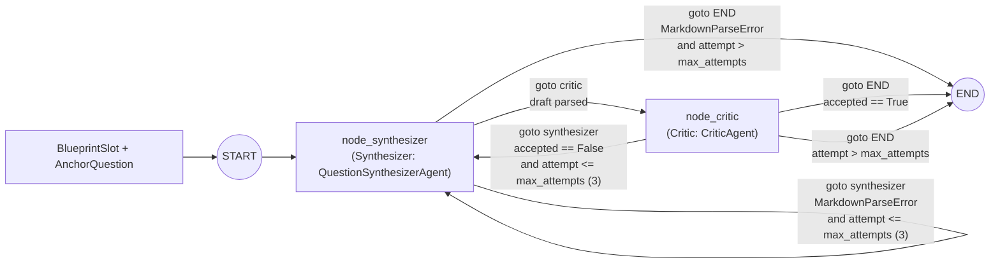

# Pipeline

## Summary

The agent pipeline has four stages. Stage 3 is the only one with working code, and it is covered by tests.

> **Status**: Partly implemented. No API route or CLI command runs any stage on this page. `ExamPipelineOrchestrator` uses separate deterministic agents, described under [Orchestrator](reference.md#orchestrator).

| Stage | Responsibility | Agents | Code today |
| --- | --- | --- | --- |
| 1 | [Ingestion and Classification](#stage-1-ingestion-and-classification) | Docling, Classifier | `DoclingClient` and `ClefClient` exist, but nothing calls them. `agents/classifier/` is a placeholder |
| 2 | [Profiling and Consensus Planning](#stage-2-profiling-and-consensus-planning) | Deterministic Python | Schemas only. Only tests build an `ExamBlueprintWithSlots` |
| 3 | [Synthesis Loop](#stage-3-synthesis-loop) | Synthesizer, Critic | Implemented and tested, but not called outside the tests |
| 4 | [Assembly and Provenance](#stage-4-assembly-and-provenance) | None | Not implemented. `AssemblyAgent` accepts `GeneratedQuestion`, not `SynthesizedQuestion` |

## Stage 1: Ingestion and Classification

This stage is planned to parse source PDFs with Docling, then have the Classifier tag each question. The result is a set of `AnchorQuestion` records.

| Item | Detail |
| --- | --- |
| Input | Source PDFs |
| Output | `AnchorQuestion` records |
| Tags on each record | Topic, format, marks, keywords, archetype, difficulty |
| Schema | `AnchorQuestion` in `synthesis_contracts.py`. See [Contracts](reference.md#contracts) |

Stage 2 pairs each blueprint slot with an exemplar `anchor_question_id` drawn from these records. Stage 3 then uses the exemplar to anchor each synthesized question.

## Stage 2: Profiling and Consensus Planning

This stage is planned as deterministic Python that balances topics and marks. It pairs each `BlueprintSlot` with an exemplar `anchor_question_id`.

| Item | Detail |
| --- | --- |
| Input | `AnchorQuestion` records from [Stage 1](#stage-1-ingestion-and-classification) |
| Output | `ExamBlueprintWithSlots`, a list of `BlueprintSlot` entries |
| Method | Deterministic Python, no model call |
| Schemas | `BlueprintSlot` and `ExamBlueprintWithSlots` in `synthesis_contracts.py`. See [Contracts](reference.md#contracts) |

Stage 3 consumes one `BlueprintSlot` plus its paired `AnchorQuestion` per cycle.

## Stage 3: Synthesis Loop

Stage 3 iterates slot by slot, one question per cycle. The Synthesizer writes an original question anchored to the exemplar, and the Critic checks correctness, solvability, and style alignment. Rejected or malformed drafts loop back to the Synthesizer with working-memory feedback for up to `max_attempts = 3`.

To prevent code indentation and LaTeX math (such as `$O(n \log n)$`) from breaking JSON escaping, both agents return structured Markdown sections, which are validated and parsed into Pydantic models. `extract_markdown_sections()` in `synthesis_contracts.py` handles section extraction.

### Synthesizer

`QuestionSynthesizerAgent` in `synthesizer.py` is the first node of the loop.

| Item | Detail |
| --- | --- |
| Key classes and functions | `QuestionSynthesizerAgent`, `build_synthesis_prompt()`, `parse_synthesized_markdown()` |
| Input | A `BlueprintSlot` and its exemplar `AnchorQuestion`, plus working-memory feedback on retries |
| Output | A `SynthesizedQuestion` parsed from Markdown sections |
| Runs in | `node_synthesizer` in the [Synthesis Graph](#synthesis-graph) |

| Section | Requirement | Content |
| --- | --- | --- |
| `## QUESTION` | Mandatory | Complete question prompt, code snippets, or mathematical setup |
| `## OPTIONS` | Mandatory when `format == "multiple_choice"`. Optional or omitted for all other formats | All 4 choices `(A)`, `(B)`, `(C)`, `(D)`. Multi-line option bodies, such as code blocks or matrices, are preserved across lines until the next option label |
| `## SOLUTION` | Mandatory | For `multiple_choice`, one of `A`, `B`, `C`, or `D`. For other formats, the complete solution code or derivation |
| `## EXPLANATION` | Mandatory | Step-by-step derivation, state trace, or proof |
| `## RATIONALE` | Mandatory | Pedagogical alignment explanation linking the question to the anchor exemplar |
| `## CODE_TEST_CASES` | Optional | Python `assert` statements for `code_writing` questions |

If the Synthesizer omits any mandatory section, or provides fewer than 4 options for a multiple-choice question, `parse_synthesized_markdown()` raises `MarkdownParseError`. `node_synthesizer` catches this error, **skips the Critic**, records a `FORMAT ERROR` in `feedback_history`, and reprompts the Synthesizer.

### Critic

`CriticAgent` in `critic.py` is the second node of the loop. It verifies each draft for correctness, solvability, and style alignment.

| Item | Detail |
| --- | --- |
| Key classes and functions | `CriticAgent`, `build_critic_prompt()`, `parse_critic_markdown()` |
| Input | A `SynthesizedQuestion` from the [Synthesizer](#synthesizer) |
| Output | A `CriticEvaluation` parsed from Markdown sections, with `CriticFeedback` on rejection |
| Runs in | `node_critic` in the [Synthesis Graph](#synthesis-graph) |

| Section | Requirement | Content |
| --- | --- | --- |
| `## ACCEPTED` | Mandatory | Boolean verdict (`true` or `false`), flexibly parsed across `**True**`, `Yes, accepted`, `false`, `No - rejected`, and similar |
| `## CORRECTNESS_STATUS` | Optional, defaults based on `ACCEPTED` | `verified`, `flagged`, or `unverified` |
| `## CODE_SANDBOX_PASSED` | Optional | `true` or `false` for `code_writing` questions. `N/A` is parsed as `None` when not applicable |
| `## STYLE_ALIGNMENT_SCORE` | Optional | Float in `[0.0, 1.0]` |
| `## ISSUES` | Optional | Bullet list of defects, or `None` |
| `## VERIFIER_NOTES` | Mandatory | Detailed critique, recorded in the slot's working memory and given to the Synthesizer on the next attempt if the question is rejected |

!!! warning "No code is executed"
    `CODE_SANDBOX_PASSED` is parsed from the LLM response. Exygen has no sandbox yet, so this value is a statement by the model, not the result of a test run. The mock LLM returns `true` for `code_writing` questions. A sandbox is planned under [Deployment](../architecture.md#sandboxes-horizontally-scaled-vms).

### Synthesis Graph

The state machine in `synthesis_graph.py` runs the Synthesizer and the Critic. The agents communicate only through LangGraph `Command`. Each node returns its state update and the next node in one object, so the graph has no conditional edges.

| Item | Detail |
| --- | --- |
| Key classes and functions | `SlotSynthesisState`, `create_slot_synthesis_graph()`, `run_slot_synthesis()`, `synthesize_exam_slots()` |
| Input | A `BlueprintSlot` and its `AnchorQuestion` |
| Retry limit | `max_attempts = 3` |
| Feedback | Working-memory feedback injected into the Synthesizer on each retry |
| Handoff mechanism | `langgraph.types.Command(update=..., goto=...)` returned by each node |

#### Agent Handoffs

Handoffs follow the `Command` primitive described in the LangGraph [Graph API](https://docs.langchain.com/oss/python/langgraph/graph-api#command) reference and the [multi-agent collaboration](https://github.com/langchain-ai/langgraph/blob/23961cff61a42b52525f3b20b4094d8d2fba1744/docs/docs/tutorials/multi_agent/multi-agent-collaboration.ipynb) tutorial. The rules for this repository are:

1. A node that hands work to another agent returns `Command(update={...}, goto="<node>")`. The update carries the new state and `goto` names the node that runs next.
2. Every node annotates its return type with the nodes it can reach, for example `Command[Literal["critic", "synthesizer", "__end__"]]`. LangGraph uses the annotation to draw the graph.
3. The only static edge is `START` to `synthesizer`. A node that returns `Command` must not also have static or conditional edges, because LangGraph runs both paths.
4. A loop ends with `goto=END`. Retry limits are checked inside the node that decides, by incrementing `attempt` in the update and comparing it with `max_attempts`.
5. Agents share data only through `SlotSynthesisState` keys. They never call each other directly.

`graph=Command.PARENT`, which hands control from a subgraph to its parent, is not used yet. The Classifier and Assembly stages are not graph nodes yet, so this loop is the only compiled graph. When it is mounted inside a larger graph, `Command.PARENT` handoffs will need a reducer in the parent for every state key they share.

#### Node Behavior

| Node | Reaches | Behavior | Update keys |
| --- | --- | --- | --- |
| `node_synthesizer` | `critic`, `synthesizer`, `END` | Runs the Synthesizer. On success it hands the draft to `critic`. On `MarkdownParseError` it records a `FORMAT ERROR`, skips the Critic, and either retries `synthesizer` or ends once `attempt > max_attempts` with a flagged placeholder question | `current_question`, and on a format error `current_evaluation`, `feedback_history`, `attempt`, plus `final_question` and `final_evaluation` once attempts run out |
| `node_critic` | `synthesizer`, `END` | Runs the Critic on the parsed draft. An accepted draft ends the loop. A rejected draft is added to `feedback_history`, then the loop retries `synthesizer` or ends once `attempt > max_attempts` with the last draft flagged | `current_evaluation`, `final_question`, `feedback_history`, `attempt`, and `final_evaluation` when the draft is accepted or attempts run out |

## Stage 4: Assembly and Provenance

This stage is planned to package the verified questions, answer keys and explanations, and the style alignment audit trace for the web studio and for PDF or Markdown export.

| Item | Detail |
| --- | --- |
| Input | Verified questions from the [Synthesis Graph](#synthesis-graph) |
| Output | Exam, answer key with explanations, and style alignment audit trace |
| Consumers | The web studio and PDF or Markdown export |
| Related contract | `AssembledExam` in `contracts.py`. See [Contracts](reference.md#contracts) |
