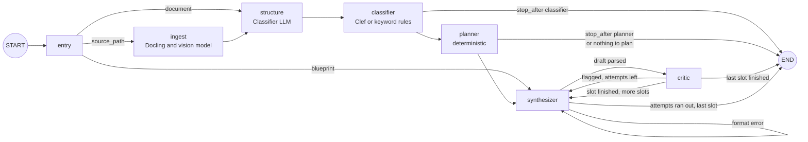

# Pipeline

## Summary

The agent pipeline has four stages. Stages 1 to 3 run in one LangGraph graph, `exygen`, in `agents/graph.py`. Stage 4 does not exist yet, so a run ends with questions and evaluations in the graph state, not with an exam.

> **Status**: Partly implemented. `python -m src run` runs the graph, as described under [Command Line](reference.md#command-line). No API route calls it, and `python -m src` with no command still runs the separate deterministic [Orchestrator](reference.md#orchestrator).

| Stage | Responsibility | Agents | Code today | Run on a real exam? |
| --- | --- | --- | --- | --- |
| 1 | [Ingestion and Classification](#stage-1-ingestion-and-classification) | Docling, vision model, Classifier, Clef | Implemented and tested | Yes, on one exam. See [Observed Runs](../evaluation.md#observed-runs) |
| 2 | [Planning](#stage-2-planning) | Planner, deterministic Python | Implemented and tested | Yes, on the same exam |
| 3 | [Synthesis Loop](#stage-3-synthesis-loop) | Synthesizer, Critic | Implemented and tested | No. Tested with the mock, plus one live test on a sample slot |
| 4 | [Assembly and Provenance](#stage-4-assembly-and-provenance) | None | Not implemented | No |

## The Exygen Graph

`create_exygen_graph()` builds the only graph in the agent. `run_exygen()` runs one exam through it, as one Langfuse trace. See [Tracing](reference.md#tracing).

| Function | Starts from | Stops |
| --- | --- | --- |
| `run_exygen()` | A file or a `SourceDocument`. A file needs `course` and `permission_status` | At the end, or at `stop_after` |
| `run_classifier()` | A `SourceDocument` | After the `classifier` node |
| `synthesize_exam_slots()` | An existing blueprint and its anchors | At the end |
| `run_slot_synthesis()` | One slot and its anchor | At the end |

A run takes one source document. Nothing combines several exams or builds a `StyleProfile` in this graph.

### Agent Handoffs

Handoffs follow the `Command` primitive described in the LangGraph [Graph API](https://docs.langchain.com/oss/python/langgraph/graph-api#command) reference and the [multi-agent collaboration](https://github.com/langchain-ai/langgraph/blob/23961cff61a42b52525f3b20b4094d8d2fba1744/docs/docs/tutorials/multi_agent/multi-agent-collaboration.ipynb) tutorial. The rules for this repository are:

1. A node that hands work to another node returns `Command(update={...}, goto="<node>")`. The update carries the new state and `goto` names the node that runs next.
2. Every node annotates its return type with the nodes it can reach, for example `Command[Literal["critic", "synthesizer", "__end__"]]`. LangGraph uses the annotation to draw the graph.
3. The only static edge is `START` to `entry`. A node that returns `Command` must not also have static or conditional edges, because LangGraph runs both paths.
4. A run ends with `goto=END`. Retry limits are checked inside the node that decides.
5. Agents share data only through `ExygenState` keys. They never call each other directly.

### Node Behavior

| Node | Reaches | Behavior | Update keys |
| --- | --- | --- | --- |
| `entry` | `ingest`, `structure`, `synthesizer` | Starts at the first stage with work to do, and raises `ValueError` if the state holds nothing to work on | None |
| `ingest` | `structure` | Extracts the file with Docling, reads its figures, and builds the `SourceDocument` | `document`, `figures`, `warnings` |
| `structure` | `classifier` | Reads the questions out of the document | `structured_questions`, `warnings` |
| `classifier` | `planner`, `END` | Tags each question | `anchors`, `warnings` |
| `planner` | `synthesizer`, `END` | Builds the blueprint, and starts the slot loop | `blueprint`, `warnings`, `slot_index`, `attempt`, `feedback_history`, `current_question`, `last_draft`, `questions`, `evaluations` |
| `synthesizer` | `critic`, `synthesizer`, `END` | Writes a draft and hands it to `critic`. On `MarkdownParseError` it records a `FORMAT ERROR`, skips the Critic, and retries. When attempts run out it finishes the slot with the last parsed draft, or a flagged placeholder if there is none | `current_question`, `last_draft`, and on a format error `feedback_history` and `attempt` |
| `critic` | `synthesizer`, `END` | Finishes the slot when the draft is accepted or `unverified`. Retries a `flagged` draft until attempts run out, with its feedback in `feedback_history`. A malformed Critic reply counts as `flagged` | `feedback_history`, `attempt`, or the slot's results |

`finish_slot()` in `nodes/slots.py` adds the slot's question and evaluation to the results, then moves to the next slot or ends the run. Each slot starts with its own attempts and feedback. A question is recorded whatever its evaluation says, so a reader must check `accepted` and `correctness_status` for each one.

The graph's step limit is `GRAPH_STEP_LIMIT = 5000`, which is well above what a 100-page exam needs and still stops a runaway loop.

## Stage 1: Ingestion and Classification

This stage turns a source file into `AnchorQuestion` records, in three steps. The Classifier agent owns the last two.

| Item | Detail |
| --- | --- |
| Input | A source file, or an existing `SourceDocument` |
| Output | `AnchorQuestion` records, `FigureRecord` entries, and warnings |
| Tags on each record | Format, topic, marks, keywords, archetype, difficulty, and how the tags were produced |
| Schemas | See [Agent Contracts](reference.md#agent-contracts) |

### Figures

Docling finds pictures but cannot read them, so `FigureReader` in `classifier/vision.py` sends each one to the vision model set by `AGENT_VISION_MODEL`. This keeps questions that depend on a diagram, or that are themselves an image, from losing information.

| Case | Result in the page text |
| --- | --- |
| Figure described | `[Figure p3-f1 on page 3, described by a vision model, which may contain errors: ...]`, in the place the figure appears |
| Figure not described after 3 attempts, or no vision model | `[Figure p3-f1 on page 3: not described]`, with a warning |
| Picture narrower or shorter than `DOCLING_FIGURE_MIN_PIXELS` | Dropped as decoration |
| Page with almost no text or figures, from a PDF or image | The whole page is rendered and transcribed, and labeled as model-generated, with a warning |

A description is a model inference, not text from the document, and nothing checks it. Every run with described figures warns the reader to check them against the source, especially arrows and connections. See [Known Limits](#known-limits).

### Reading the Questions

The `structure` node asks the Classifier LLM to copy out each question, including its parts and `[Figure ...]` markers. `AGENT_CLASSIFIER_READING_MODE` sets how much it reads at once:

| Mode | Behavior |
| --- | --- |
| `whole_document` | One request for the document, so a question that crosses a page break stays whole |
| `per_page` | One request per page. A question that crosses a page break comes back in two parts |
| `auto` | Reads page by page only when the document has one page, is longer than `AGENT_CLASSIFIER_WHOLE_DOCUMENT_MAX_CHARS`, or starts a question on every page from the first question on. Otherwise it reads the whole document |

A document whose `document_type` is not `exam` gives no questions, with a warning.

Everything the LLM returns is checked against the source. These checks use no model:

| Value | Check | If it fails |
| --- | --- | --- |
| Question text | Each word must follow the last within `MAX_SOURCE_GAP_CHARS` (40) characters of the source, ignoring whitespace, curly quotes, and Markdown markup the model added | The question is dropped with a warning |
| Page number | Taken from where the text was found, never from the LLM | Not applicable |
| Marks | The number must appear on that page | The value becomes `None`, with a warning |
| Keywords | The term must appear in the question | The keyword is dropped |

A reply that cannot be parsed is retried, for up to 3 attempts, with the format error in the prompt. After that the section is skipped with a warning.

The check confirms that text came from the source. It does not confirm that the LLM found every question, so a question it leaves out is lost with no warning.

### Tagging the Questions

The `classifier` node tags each question with Clef, and records `tag_source` and each tag's `tag_confidence`.

| Tag | Clef question | Without Clef |
| --- | --- | --- |
| `detected_format` | Choice of `multiple_choice`, `short_answer`, `code_writing`, `algorithm_design` | Keyword rules, or `None` unless one rule clearly matches |
| `topic` | Choice from a fixed list of CS topics | Keyword rules, or `None` unless one rule clearly matches |
| `archetype` | Choice from a fixed list, such as `code_tracing` or `proof` | `None` |
| `difficulty_estimate` | A score rounded to `easy`, `medium`, or `hard` | `None` |

If Clef is not configured, or fails on a question, that question falls back to keyword rules with `tag_source` set to `keyword_rules` and a warning. See [Data Policy](../resources/data-policy.md) for what is sent to Cloudflare.

## Stage 2: Planning

`ExamPlanner` in `planner/base.py` builds the blueprint with no model call, so the same anchors always give the same blueprint.

| Item | Detail |
| --- | --- |
| Input | `AnchorQuestion` records, in exam order |
| Output | `ExamBlueprintWithSlots`, or `None` when nothing can be planned |
| Method | One slot per anchor, copying its measured values |
| Skipped | An anchor with no topic or format, with a warning |
| Kept as `None` | `target_marks` and `difficulty`, because the Synthesizer can work without them and a pass/fail exam has no marks |
| `total_marks` | The sum of the slots' marks, or `None` unless every slot has marks |

The Planner copies the source exam's shape. It does not balance topics or marks, and it does not read `ExamGenerationRequest`, so a user cannot yet choose question count, difficulty, or topics for this graph.

## Stage 3: Synthesis Loop

Stage 3 works through the blueprint one slot at a time. The Synthesizer writes an original question anchored to the exemplar, and the Critic checks correctness, solvability, and style alignment. A flagged or malformed draft loops back to the Synthesizer with working-memory feedback, for up to `max_attempts = 3` drafts per slot.

To prevent code indentation and LaTeX math (such as `$O(n \log n)$`) from breaking JSON escaping, both agents return structured Markdown sections, which are validated and parsed into Pydantic models. `extract_markdown_sections()` in `agents/schemas.py` handles section extraction.

Text from a source exam or a draft reaches these prompts inside `<source_text>` tags, and each prompt says to treat that text as data. `wrap_source_text()` neutralizes a closing tag inside the text. This lowers the risk of prompt injection but cannot rule it out. A value that was not measured appears in a prompt as `Not measured`.

### Synthesizer

`QuestionSynthesizerAgent` in `synthesizer/base.py` writes each draft.

| Item | Detail |
| --- | --- |
| Key classes and functions | `QuestionSynthesizerAgent`, `build_synthesis_prompt()`, `parse_synthesized_markdown()` |
| Input | A `BlueprintSlot` and its exemplar `AnchorQuestion`, plus working-memory feedback on retries |
| Output | A `SynthesizedQuestion` parsed from Markdown sections |
| Runs in | The `synthesizer` node |

| Section | Requirement | Content |
| --- | --- | --- |
| `## QUESTION` | Mandatory | Complete question prompt, code snippets, or mathematical setup |
| `## OPTIONS` | Mandatory when `format == "multiple_choice"`. Optional or omitted for all other formats | All 4 choices `(A)`, `(B)`, `(C)`, `(D)`. Multi-line option bodies, such as code blocks or matrices, are preserved across lines until the next option label |
| `## SOLUTION` | Mandatory | For `multiple_choice`, one of `A`, `B`, `C`, or `D`. For other formats, the complete solution code or derivation |
| `## EXPLANATION` | Mandatory | Step-by-step derivation, state trace, or proof |
| `## RATIONALE` | Mandatory | Pedagogical alignment explanation linking the question to the anchor exemplar |
| `## CODE_TEST_CASES` | Optional | Python `assert` statements for `code_writing` questions. Nothing runs them |

If the Synthesizer omits any mandatory section, or provides fewer than 4 options for a multiple-choice question, `parse_synthesized_markdown()` raises `MarkdownParseError`.

### Critic

`CriticAgent` in `critic/base.py` reviews each draft for correctness, solvability, and style alignment.

| Item | Detail |
| --- | --- |
| Key classes and functions | `CriticAgent`, `build_critic_prompt()`, `parse_critic_markdown()` |
| Input | A `SynthesizedQuestion` from the [Synthesizer](#synthesizer), its slot, and its anchor |
| Output | A `CriticEvaluation` parsed from Markdown sections |
| Runs in | The `critic` node |

| Section | Requirement | Content |
| --- | --- | --- |
| `## ACCEPTED` | Mandatory | A verdict that fails closed. A negation or negative word, as in `not accepted` or `true but flagged`, reads as false. Text with no verdict raises `MarkdownParseError` |
| `## CORRECTNESS_STATUS` | Requested by the prompt | `verified`, `flagged`, or `unverified`. Without an explicit `verified`, a question is not accepted |
| `## STYLE_ALIGNMENT_SCORE` | Optional | A number from 0 to 1, a percentage, or a fraction. Anything else is `None`, and nothing estimates a value |
| `## ISSUES` | Optional | Bullet list of defects, or `None` |
| `## VERIFIER_NOTES` | Mandatory | Detailed critique, recorded in the slot's working memory and given to the Synthesizer on the next attempt if the draft is flagged |

The result is binary: `accepted` is true only when the status is `verified`.

| `## ACCEPTED` | `## CORRECTNESS_STATUS` | Format | `accepted` | Final status | Next step |
| --- | --- | --- | --- | --- | --- |
| Any | Contains `unverified` | Any | `false` | `unverified` | Kept for human review, no retry |
| Any | Contains `flagged` | Any | `false` | `flagged` | Retry |
| `false` | Any other value | Any | `false` | `flagged` | Retry |
| `true` | No `verified` | Any | `false` | `unverified` | Kept for human review, no retry |
| `true` | `verified` | `code_writing` | `false` | `unverified` | Kept for human review, no retry |
| `true` | `verified` | Any other format | `true` | `verified` | Slot finished |

!!! warning "What `verified` means today"
    A `verified` question has been approved only by the Critic LLM reading it. No separate check confirms the answer, so treat it as reviewed, and have a person check it before use. The style score is also the model's opinion, not a measurement, and it does not affect the verdict.

!!! warning "No code is executed"
    Code cannot reach `verified` without a real sandbox run, and Exygen has no sandbox yet. `code_sandbox_passed` is always `None`. A reply containing `## CODE_SANDBOX_PASSED` is ignored, the prompt no longer asks for it, and an approved `code_writing` draft gets the note `Reviewed by the LLM, not executed, so it is not verified.` Only `code_writing` counts as code, so code inside another format is not held back this way. See [Sandboxes](../architecture.md#sandboxes-horizontally-scaled-vms) for the plan.

## Stage 4: Assembly and Provenance

This stage is planned to package the reviewed questions, answer keys and explanations, and the style alignment audit trace for the web studio and for PDF or Markdown export. It does not exist yet.

| Item | Detail |
| --- | --- |
| Input | `questions` and `evaluations` from the [Synthesis Loop](#stage-3-synthesis-loop) |
| Output | Exam, answer key with explanations, and style alignment audit trace |
| Consumers | The web studio and PDF or Markdown export |
| Related contract | `AssembledExam` in `schemas/exam.py`. See [Contracts](reference.md#contracts). `AssemblyAgent` accepts `GeneratedQuestion`, not `SynthesizedQuestion` |

## Known Limits

| Limit | Effect |
| --- | --- |
| Provider errors are not handled per slot | Only `MarkdownParseError` is caught in the Classifier LLM, Synthesizer, and Critic steps. A provider error ends the run, and slots already finished are lost |
| Rate limits are not retried | `ChatOpenRouter` does not retry HTTP 429, which free models are likely to return |
| Near-duplicates are not detected | The graph has no lexical or semantic check. Only the Critic LLM's reading looks for a copied anchor, and `CriticEvaluation` has no `duplicate_risk` |
| Figure descriptions can be wrong | On one real exam, the free models tested misread which node crossing arrows point to, while class diagrams came out right. Paid vision models are untested |
| Code layout is lost in extraction | Docling flattens code blocks onto one line and can join words, as in `anexample`. `DOCLING_DO_CODE_ENRICHMENT` took 242 seconds and misread text on the exam tried, and forced OCR added character errors, so both stay off |
| Multi-part questions get one tag | Clef tags the whole question, so its parts share one format, topic, and difficulty |
| Runs vary | `AGENT_TEMPERATURE` defaults to `0.7`, so question text and descriptions differ between runs |
