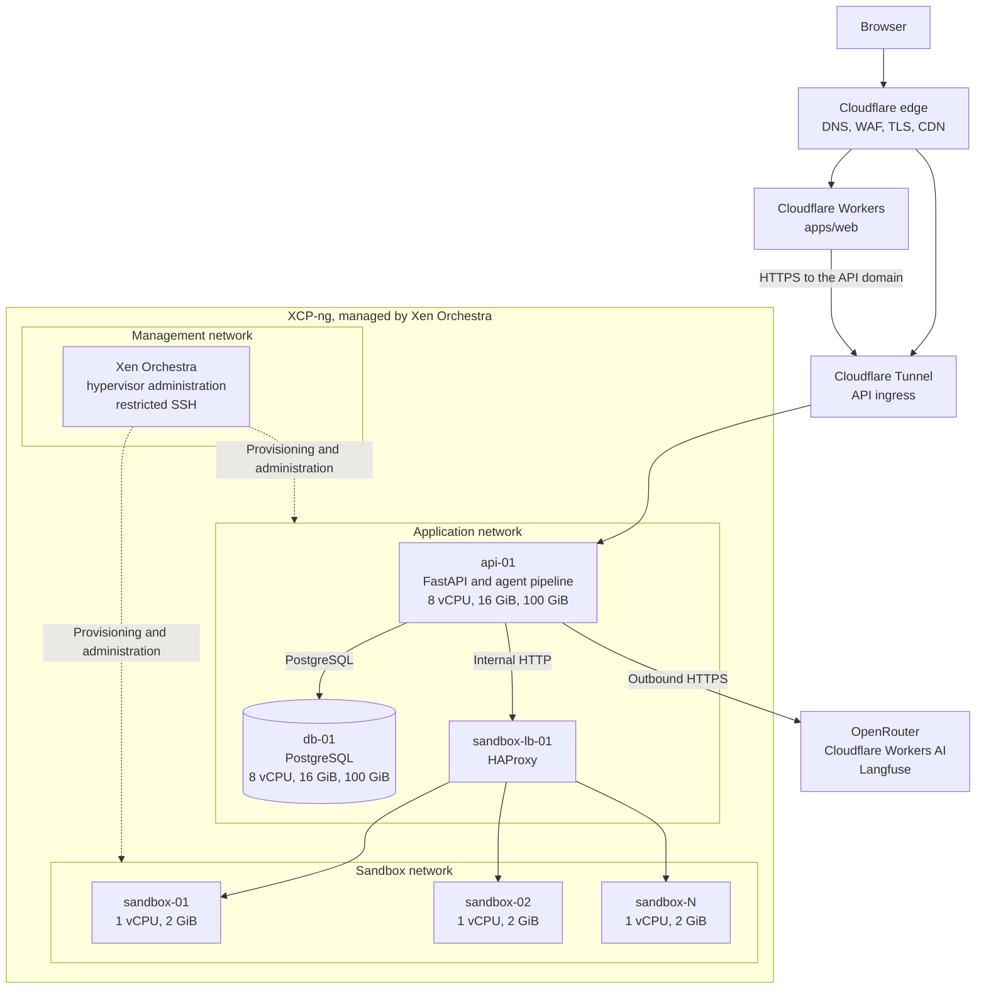
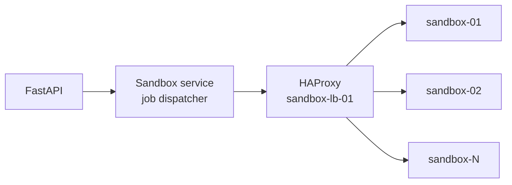

# Architecture

## Summary

Exygen transforms authorized historical Computer Science exams and course materials into original, instructor-style practice exams, then verifies each question and answer before showing the result.

This page summarizes the blueprint in `.agents/index.md`, which remains the source of truth for scope, contracts, and rules, and it records the planned [Deployment](#deployment). Update this page when the implementation diverges from the blueprint, and record the change in the relevant component changelog.

## Pipeline

The blueprint runs agents in sequence, with bounded retries, structured error reports, and saved intermediate outputs. Two implementations exist today, and they share no code path:

- The [Exygen Graph](agent/pipeline.md#the-exygen-graph) is the LLM-backed pipeline. It covers extraction, planning, generation, and validation, with bounded retries for each question, and `python -m src run` runs it. It does not build a style profile, assemble an exam, or save intermediate outputs yet.
- [`ExamPipelineOrchestrator`](agent/reference.md#orchestrator) runs each role below once with deterministic agents, with no retries or saved outputs. The offline demo uses it.

| Stage | Agent | Output |
| --- | --- | --- |
| 1 | Extraction | `ExtractedExam` objects with questions and citations |
| 2 | Style Analysis | `StyleProfile` with evidence and confidence |
| 3 | Planning | `ExamBlueprint` |
| 4 | Generation | `GeneratedQuestion[]` with solutions |
| 5 | Validation | `ValidationReport` and revision requests |
| 6 | Assembly | Exam, answer key, and alignment summary |

A human reviews the result before export.

## Monorepo

| Project | Path | Stack |
| --- | --- | --- |
| `agent` | `apps/agent` | Python 3.12+, Pydantic, multi-agent pipeline |
| `api` | `apps/api` | Python 3.12+, FastAPI |
| `web` | `apps/web` | TypeScript, React, Vite, Tailwind CSS, TanStack |
| `docs` | `apps/docs` | Zensical (Python 3.14+) |

## Design Rules That Affect Docs

- Distinguish facts extracted from documents from model inferences.
- Do not describe generated answers as correct without verification.
- Report instructor-style alignment separately from correctness, and never claim a perfect match.
- Do not publish restricted exams, student data, or secrets in docs.

## Deployment

> **Status**: Planned. Nothing in this section is deployed. Exygen runs only in local development today. The repository has no Dockerfile, no Worker configuration for `apps/web`, no database, and no sandbox service. See [Current State](#current-state).

The web app runs on Cloudflare Workers. The API, PostgreSQL, and the code sandboxes run on VMs managed by Xen Orchestra on XCP-ng. Cloudflare is the only public entry point. This first topology has single points of failure. See [Availability Limitations](#availability-limitations).

### How to Read This Section

| Label | Meaning |
| --- | --- |
| **Decided** | The team has made this decision. Changing it means updating this section |
| **Recommended** | A proposed default. Implementation can change it without revisiting the architecture |
| **Open** | Not decided. Listed under [Open Questions](#open-questions) |

Subsections describe decided requirements unless they are labeled otherwise.

### Decided Architecture

| Area | Decision |
| --- | --- |
| Frontend hosting | Cloudflare Workers |
| Infrastructure management | XCP-ng and Xen Orchestra (XO5/XO6) |
| API | One vertically scaled VM at first, running Python and FastAPI in Docker |
| API minimum allocation | 8 vCPU, 16 GiB RAM, 100 GiB storage |
| Database | PostgreSQL on a separate VM with the same initial allocation |
| Sandboxes | Multiple lightweight VMs with 1 vCPU and 2 GiB RAM each |
| Sandbox load balancing | HAProxy |
| Scaling | Vertical for the API and database at first, horizontal for sandboxes |
| External ingress | Cloudflare, preferably Cloudflare Tunnel |
| Security | Private networking, strict sandbox isolation, no public database access |

Kubernetes, Firecracker, and other major orchestration technologies are not part of this architecture. Adding one as a mandatory component needs a documented technical justification.

### Topology

This diagram shows the logical architecture. Exact networking and the number of sandbox VMs will be set during implementation.



The web app never connects directly to the database or to a sandbox VM. Sandbox VMs cannot start connections to the application or management networks.

### Current State

The plan starts from the repository as it is today. These gaps must close before the API or web app can be deployed.

| Area | What exists today | Needed for this plan |
| --- | --- | --- |
| API packaging | Sources now live at `apps/api/src/exygen_api`, matching the wheel, Nx targets, and test import. The API imports the agent's `src` exports, and its built wheel contains `exygen_api/main.py`. Container runtime verification is still pending | Verify the API container and its `/health` endpoint |
| API container | No Dockerfile | A container image for `apps/api` that includes `apps/agent` |
| API state | `InMemoryStore` in `apps/api/src/exygen_api/main.py`. State is lost on restart and is not shared between worker processes, so the API cannot use its vCPUs through multiple workers yet | Persistence in PostgreSQL |
| API settings | `apps/api/src/exygen_api/settings.py` is empty | Environment-based configuration |
| CORS | `allow_origins` is hard-coded to `localhost:3000` and `127.0.0.1:3000` | Allowed origins set per environment |
| Authentication | None. Every endpoint is open, including those that start paid LLM calls | Authentication and rate limits before public exposure |
| Exam generation | `POST /api/exams` runs the whole pipeline inside the request | A request model that fits [Cloudflare's limits](#cloudflare-limits) |
| Web failure handling | `fetchWithFallback` and `generatePracticeExam` in `apps/web/src/lib/api.ts` return hard-coded fixtures on any API failure. An outage or timeout would show a fixture exam as if it had been generated | Visible errors in production, with fixtures kept for the offline demo |
| Web hosting | No Worker configuration. `apps/docs/wrangler.toml` configures the docs site only | Worker configuration for `apps/web` |
| Database | None. `make migrate` does nothing | PostgreSQL, a schema, and migrations |
| Sandbox | None. No code executes, `code_sandbox_passed` is always `None`, and no code question can reach `verified` | A sandbox service, with the result taken from real execution. See [Sandboxes](#sandboxes-horizontally-scaled-vms) |
| CI/CD | No `.github/workflows` directory | Build and deploy pipelines |

#### Hosted Database Dependencies

The repository has no Supabase client, dependency, configuration, or schema, and it has no other hosted database. There is no existing database to migrate from the code's point of view. See [Open Questions](#open-questions) if a project exists outside this repository.

A dedicated PostgreSQL VM does not include the managed features of a platform such as Supabase. If Exygen needs one of these features later, it must be built or chosen separately.

| Managed feature | Used by Exygen today | Replacement if needed |
| --- | --- | --- |
| Authentication | No | **Open**. The API has no authentication yet |
| File storage | No | **Open**. See [Open Questions](#open-questions) |
| Generated REST API | No | FastAPI endpoints in `apps/api` |
| Realtime | No | Polling through `GET /api/exams/{id}` |
| Managed backups and recovery | No | [Backups](#backups) |

### Frontend: Cloudflare Workers

`apps/web` will run on Cloudflare Workers.

- Deploy the frontend through Cloudflare Workers, with separate production and development environments.
- Keep the frontend independent of the Xen Orchestra infrastructure.
- Route API requests to a dedicated API domain, such as `api.example.com`. This hostname is an example. The domain is **Open**.
- Use Cloudflare DNS, HTTPS/TLS, WAF, and relevant security controls.
- Configure CORS on the API, because the frontend and API use different origins.
- Keep secrets and privileged backend operations off the client.

#### Implementation Notes

- TanStack Start runs on Workers through `@cloudflare/vite-plugin` and a Wrangler configuration. See the [Cloudflare guide](https://developers.cloudflare.com/workers/framework-guides/web-apps/tanstack-start/). Neither is in `apps/web` yet.
- `apps/web/src/lib/api.ts` reads the API URL from `import.meta.env.VITE_API_URL`. Vite resolves this value at build time, so each environment needs its own build.
- Any `VITE_` value ships to the browser. Never put a secret in one.

#### Cloudflare Limits

These limits come from the [connection limits](https://developers.cloudflare.com/fundamentals/reference/connection-limits/) and [upload limits](https://developers.cloudflare.com/support/troubleshooting/http-status-codes/4xx-client-error/error-413/) pages, and they shape the API design.

| Limit | Value | Effect on Exygen |
| --- | --- | --- |
| Proxy read timeout | 125 seconds, returns HTTP 524. Only Enterprise zones can change it | A long `POST /api/exams` can fail. `DOCLING_DOCUMENT_TIMEOUT_SECONDS` and `AGENT_TIMEOUT_SECONDS` both default to 300, which is longer than this limit. One [observed run](evaluation.md#observed-runs) took about 6 minutes to reach the planner on free models |
| Maximum upload size | 100 MB on Free and Pro, 200 MB on Business | `DOCLING_MAX_FILE_SIZE_MB` defaults to 25, which fits |

Treat the read timeout as applying to Tunnel traffic, and confirm this with a test on the chosen plan.

### API: Vertically Scaled VM

| Resource | Requirement |
| --- | --- |
| VM name | `api-01` |
| CPU | 8 vCPU |
| Memory | 16 GiB RAM |
| Storage | 100 GiB |
| Operating system | Ubuntu Server LTS or equivalent |
| Application | Python and FastAPI |
| Deployment | Docker containers |
| Scaling strategy | Vertical at first |

This allocation is comparable to a heavy-compute DigitalOcean Droplet. The target is a VM managed through Xen Orchestra, and no DigitalOcean instance has been selected.

Requirements:

- Host the API separately from the database and sandbox workers.
- Containerize the API with Docker, with CPU and memory limits.
- Expose the API through Cloudflare Tunnel or an equivalent secure ingress.
- Prevent direct public access to backend ports.
- Implement health checks, graceful shutdown, and restart policies.
- Reach the database and sandbox service over private networks.
- Use environment-based configuration and secure secret management.
- Keep the ability to expand CPU, memory, and storage.

Horizontal API replication and API load balancing can be added later if capacity or availability needs justify them.

#### Recommended

- **Run the agent pipeline inside the API container.** `exygen-api` already depends on `exygen-agent`, so `apps/agent` needs no host of its own. This makes `api-01` responsible for pipeline work, including Docling and OCR. Stage 3 waits mostly on LLM calls, while Docling and OCR use local CPU and memory.
- **Measure before tuning.** Docling publishes no minimum specification that we could find, so load test real documents on `api-01` before setting container limits and worker counts.
- **Include Docling models in the image.** The VM then does not download models at startup.
- **Run `cloudflared` as a container on `api-01`.** Tunnel makes [outbound-only connections](https://developers.cloudflare.com/cloudflare-one/connections/connect-networks/), so the VM needs no inbound public port.
- **Separate readiness from liveness.** `GET /health` reports only that the process is up. Add a readiness check that also confirms the database connection.

#### Outbound Dependencies

| Service | Purpose | Settings |
| --- | --- | --- |
| OpenRouter | LLM calls for the Classifier, Synthesizer, and Critic, and vision calls for figures | `AGENT_OPENROUTER_*`, `AGENT_VISION_*` |
| Cloudflare Workers AI | Clef classification | `CF_*`, `AGENT_CLEF_*` |
| Langfuse | Agent traces | `LANGFUSE_*` |

### Database: Dedicated VM

| Resource | Requirement |
| --- | --- |
| VM name | `db-01` |
| CPU | 8 vCPU |
| Memory | 16 GiB RAM |
| Storage | 100 GiB at first |
| Database | PostgreSQL |
| Scaling strategy | Vertical at first |

Storage is provisional. It must stay expandable as records, indexes, transaction logs, and retention needs grow.

Requirements:

- Host PostgreSQL separately from the API.
- Expose PostgreSQL only over an authorized private network, and never to the public Internet.
- Restrict database connections through firewall rules.
- Configure authentication, TLS where appropriate, and least-privilege roles.
- Implement automated backups and point-in-time recovery where feasible.
- Monitor storage use, connections, memory pressure, and query performance.
- Plan for future replication and high availability.
- Store backups independently of the database VM and its host.

#### Recommended: Access from FastAPI

- `api-01` connects over the application network, with the connection string supplied by the environment.
- The application uses a role with data access only. A separate role with schema privileges runs migrations during deployment.
- `make migrate` runs the migrations. It does nothing today. The migration tool is **Open**, with Alembic as the likely default for a Python service.
- Size each worker's connection pool so the total stays below `max_connections`.
- Put storage behind an interface. The blueprint requires a repeatable offline demo, so local runs must keep working without PostgreSQL.

The first data to move is what `InMemoryStore` holds today: documents, extracted exams, style profiles, and assembled exams.

#### Backups

- Take automated base backups and archive write-ahead logs for point-in-time recovery. `pgBackRest` and `WAL-G` are candidates. **Recommended**.
- Keep backups off the database VM and off its physical host.
- Schedule restore tests. A backup that has not been restored is unproven.

### Sandboxes: Horizontally Scaled VMs

!!! warning "This section is being replaced"
    Code verification is now planned through [Daytona](https://www.daytona.io/) on the team's own servers, as a tool or node in the agent graph. This is deferred and nothing is built yet. The worker VMs and HAProxy described here and in [Sandbox Load Balancing](#sandbox-load-balancing-haproxy) have not been rewritten for that plan, so check with the team before building from them.

| Resource | Requirement |
| --- | --- |
| VM naming | `sandbox-01`, `sandbox-02`, and so on |
| CPU | 1 vCPU per VM |
| Memory | 2 GiB RAM per VM |
| Storage | Minimal, sized for the OS, runtime, and temporary execution data. The exact size is **Open** |
| Scaling strategy | Horizontal |
| Workload | Isolated code execution |

These allocations are per VM, not for the whole cluster. Sandbox VMs can be added or removed without changing the frontend or the public API contract.

Requirements:

- Execute user-supplied or AI-generated code in isolated environments. The pipeline only produces AI-generated code today, and student code submission is not in product scope. Treat all of it as untrusted.
- Keep sandbox infrastructure separate from the API and database VMs.
- Use disposable execution environments inside each VM where appropriate.
- Evaluate a hardened container runtime such as gVisor.
- Enforce execution deadlines.
- Limit CPU, memory, process count, filesystem access, and output size.
- Restrict network egress by default.
- Prevent access to internal infrastructure, database credentials, API secrets, hypervisor management interfaces, and host container sockets.
- Clean up execution environments and temporary files after each job.
- Implement execution logging and failure reporting.
- Provide secure internal service endpoints.

#### Workload Limits

A VM with 1 vCPU and 2 GiB RAM suits short, single-purpose runs. The intended workload is running the test cases of generated `code_writing` questions (`code_test_cases` in `agents/schemas.py`). Supported languages are **Open**.

It does not suit long-running processes, network services, large builds, GPU work, or jobs that need network access or large datasets.

#### Recommended: Per-Job Allocation

These are provisional starting values, not measurements. Replace them after testing the real runtime.

| Limit | Starting value |
| --- | --- |
| Concurrent jobs per VM | 1 |
| Reserved for guest OS, container runtime, and worker | About 768 MiB |
| Job memory | 1 GiB, including any in-memory filesystem |
| Job CPU | 0.8 vCPU, which leaves time for the worker to answer health checks |
| Job processes | 64 |
| Wall-clock deadline | 10 to 30 seconds |
| Captured output | 1 MiB |
| Writable filesystem | In-memory only, 256 MiB |
| Network | None |

With one job per VM, N sandbox VMs run at most N jobs at once.

#### Recommended: Isolation

- Run each job in a new container, and delete it after the job.
- Evaluate gVisor with its default `systrap` platform. The [gVisor documentation](https://gvisor.dev/docs/user_guide/platforms/) advises against its KVM platform inside a VM.
- Keep the container socket away from job containers. The worker that starts jobs needs runtime access, so a compromised worker means a compromised VM. The VM and network boundaries are the last line of defense.
- Build runtime images into the VM template, so sandbox VMs need no registry or Internet access.
- Replace sandbox VMs from an updated template instead of patching them in place.
- Never give a sandbox source documents, secrets, or database access. A job receives only the code and test cases it runs.

#### Using the Result

The Critic must take `code_sandbox_passed` from real execution before Exygen reports code as checked. If the sandbox is unavailable, times out, or returns an infrastructure error, the result must stay `None` (not run). It must never become `true`. Today it is always `None`, because the sandbox does not exist.

### Sandbox Load Balancing: HAProxy

XCP-ng and Xen Orchestra manage VMs, but they do not route application traffic between them. HAProxy fills this role for the sandbox cluster.

!!! note "Xen Orchestra's load balancing plugin is different"
    Xen Orchestra has a [load balancing plugin](https://docs.xen-orchestra.com/load_balancing), but it migrates VMs between hosts to balance host load. It does not distribute network requests, so it does not replace HAProxy.

| Component | Responsibility |
| --- | --- |
| `sandbox-lb-01` | HAProxy load balancer |
| `sandbox-01` | Execution worker |
| `sandbox-02` | Execution worker |
| `sandbox-N` | Additional execution workers |



Requirements:

- Distribute requests across healthy sandbox service instances.
- Support adding and removing backends.
- Implement health checks, and stop sending new requests to unhealthy workers.
- Provide internal-only endpoints.
- Use appropriate connection limits and timeouts.
- Expose metrics for active connections, backend health, and failures.
- Run on a dedicated VM or an appropriately isolated infrastructure VM.

!!! warning "HAProxy is not a job scheduler"
    HAProxy distributes network traffic. It does not manage job state, retries, results, or worker resources, so it must not be presented as a replacement for execution scheduling.

#### Execution Mode

The execution mode is **Open**, and the traffic flow above is not final until it is chosen.

| Mode | How it works | Fits when | Main cost |
| --- | --- | --- | --- |
| Synchronous | The pipeline calls the sandbox and waits | Jobs are short and bounded | Workers stay busy while waiting. Bursts wait in the queue |
| Asynchronous | A dispatcher and a broker such as Redis assign jobs to workers | Jobs are long-running or stateful, or need retries and capacity-aware scheduling | One more stateful service to run, monitor, and back up |
| Hybrid | Exam generation is asynchronous for the client. Sandbox calls inside the pipeline are synchronous | Exam generation is slow, but each code run is short | The API needs background jobs and a status model |

**Recommended**: hybrid, with no broker in the first version.

- The 125 second Cloudflare read timeout makes a synchronous `POST /api/exams` unsafe, whatever the sandbox does. The endpoint would create a job and return its ID, and the client would poll `GET /api/exams/{id}`. This changes the current API contract.
- Each test run is short and bounded, so an internal HTTP call through HAProxy is enough at first. The dispatcher can start as a module in the API.
- Add Redis or another broker when jobs outgrow HAProxy's timeouts, or when retries, durable job state, or capacity-aware scheduling are needed. This follows the blueprint rule against adding infrastructure the workflow does not need.

#### Recommended: Starting Configuration

This example shows the intended behavior. It has not been tested, and the addresses and timeouts are placeholders.

```text
defaults
    mode http
    timeout connect 5s
    timeout client  60s
    timeout server  45s
    timeout queue   30s

frontend sandbox_internal
    bind 10.0.1.10:8080
    default_backend sandbox_workers

backend sandbox_workers
    balance leastconn
    option httpchk GET /healthz
    server sandbox-01 10.0.2.11:8080 check maxconn 1
    server sandbox-02 10.0.2.12:8080 check maxconn 1
```

- `balance leastconn` suits jobs with varying run times.
- `maxconn 1` matches one job per VM. Extra requests [wait in the HAProxy queue](https://www.haproxy.com/documentation/haproxy-configuration-tutorials/performance/overload-protection/) instead of overloading a worker.
- When `timeout queue` expires, the caller gets HTTP 503. The API must record that code as not run, not as failed.
- `timeout server` must exceed the longest job deadline.
- Retry jobs in the dispatcher, where job state is known. Do not rely on HAProxy to retry a job that has started.

### Networking and Security

#### Networks

| Network | Services |
| --- | --- |
| Management | Xen Orchestra, hypervisor administration, restricted SSH |
| Application | API, database, internal load balancing |
| Sandbox | Sandbox workers and execution traffic |

Network isolation must be enforced through routing and firewall controls, not VLAN separation alone.

#### Recommended: Allowed Traffic

Deny everything that this table does not allow. **Recommended**: connect `sandbox-lb-01` to both the application and sandbox networks, as the only path between them.

| From | To | Purpose |
| --- | --- | --- |
| `cloudflared` on `api-01` | Cloudflare (outbound) | Tunnel connections |
| `cloudflared` on `api-01` | API container | Forward ingress traffic |
| `api-01` | `db-01` | PostgreSQL |
| `api-01` | `sandbox-lb-01` | Sandbox requests |
| `api-01` | Internet (outbound HTTPS) | [Outbound dependencies](#outbound-dependencies) |
| `sandbox-lb-01` | `sandbox-N` | Job requests and health checks |
| `db-01` | Backup target | Backups and log archives |
| Management network | All VMs | Administration by authorized operators |

These paths must stay blocked:

| From | To |
| --- | --- |
| Internet | Any VM, inbound |
| Web app | `db-01` or any sandbox VM |
| Sandbox network | Application network, management network, or Internet |
| `sandbox-lb-01` | `db-01` or the management network |

#### Enforcement Options

The tool that enforces these rules is **Open**. One option is the Xen Orchestra [SDN Controller](https://docs.xen-orchestra.com/sdn_controller), which provides private networks and per-VIF traffic rules. It ships with XOA Premium. A firewall VM or host-level firewall rules are the alternatives.

#### Other Controls

- Keep Cloudflare as the primary public entry point, and use Tunnel where appropriate to avoid exposing origin ports.
- Keep database and sandbox addresses private.
- Use encrypted internal connections where appropriate.
- Restrict infrastructure administration to authorized operators.
- Keep secrets out of the repository, images, and client code. Inject them at deployment. The secret management tool is **Open**.
- Give sandbox VMs no secrets at all.
- DNS, service discovery, and internal addressing are **Open**. **Recommended**: start with static private addresses and internal DNS names, because the VM count is small.

### Scaling

| Scaling type | Applies to | How it works |
| --- | --- | --- |
| Vertical | `api-01`, `db-01` | Increase VM resources through Xen Orchestra, up to the capacity of the physical host |
| Horizontal | `sandbox-01` to `sandbox-N` | Provision more VMs, then register them with HAProxy and the job dispatcher |

#### Sandbox Scaling

Scaling should eventually be driven by execution queue depth, CPU and memory use, execution latency, and active-job capacity.

Xen Orchestra does not provision VMs in response to HAProxy traffic. Any autoscaling controller, provisioning automation, or dynamic backend registration must be built separately. Scaling starts as a manual step.

#### Host Capacity

The known allocations add up as follows. They exclude the XCP-ng control domain, Xen Orchestra, `sandbox-lb-01`, monitoring, and sandbox disks, none of which have a decided size.

| Set of VMs | vCPU | RAM | Storage |
| --- | --- | --- | --- |
| `api-01` and `db-01` | 16 | 32 GiB | 200 GiB |
| Each sandbox VM | 1 | 2 GiB | **Open** |
| `api-01`, `db-01`, and 4 sandbox VMs | 20 | 40 GiB | 200 GiB plus sandbox disks |

The API and database allocations are starting points, not values derived from load tests. Revisit them once real measurements exist.

### Operations

These are the expected practices. Tool names are **Recommended** unless they are stated as decided elsewhere in this section.

| Area | Plan |
| --- | --- |
| VM provisioning and lifecycle | Xen Orchestra, using VM templates and cloud-init |
| Infrastructure as Code | Terraform or OpenTofu with the [Xen Orchestra provider](https://docs.xen-orchestra.com/automation/terraform-provider), where feasible. The provider needs a template with cloud-init support |
| Configuration management | Ansible or equivalent |
| Container images | Build in CI, tag by commit, and push to a private registry. The registry is **Open** |
| CI/CD | Pipelines for the Worker, API image, and sandbox templates. None exist yet |
| Infrastructure monitoring | Prometheus and Grafana for VMs, API, PostgreSQL, and HAProxy |
| Agent observability | Langfuse. The client exists in `apps/agent`, and `LANGFUSE_*` configures it |
| Centralized logging | A shared log store. The tool is **Open**. Logs must not contain secrets, exam text, or personal data |
| Secret management | **Open** |
| Backups | [Automated, off-host, and restore tested](#backups) |
| Patching | Regular security updates for hosts, VMs, and images. Sandbox VMs are replaced from updated templates |
| Disaster recovery | A written and rehearsed procedure. Recovery targets are **Open** |
| Capacity planning | Review host use and growth against [Host Capacity](#host-capacity) |

#### Recommended: Deployment Workflows

1. **Web**: CI builds with the environment's `VITE_API_URL`, then runs `wrangler deploy` to the matching Worker environment.
2. **API**: CI builds and tests the image, and migrations run with the migration role. `api-01` then pulls the image, restarts the container, and passes its readiness check.
3. **Database**: schema changes ship as migrations. Take a backup before any risky change.
4. **Sandboxes**: build a new template, provision a VM from it, add it to HAProxy, and confirm it is healthy. Then drain and remove an old VM.

#### Availability Limitations

| Component | Effect of failure | Possible later mitigation |
| --- | --- | --- |
| `api-01` | The API and exam generation stop. The web app can load but cannot do real work | A second API VM behind a load balancer, once state is in PostgreSQL |
| `db-01` | The API loses all persistent data access until restore or repair | Replication and failover |
| `sandbox-lb-01` | Code verification stops. API and web requests that do not need a sandbox keep working | A second HAProxy instance |
| One sandbox VM | Capacity drops. HAProxy stops sending it work | Spare VMs |
| `cloudflared` on `api-01` | The API is unreachable from the Internet | A second connector for the same tunnel |
| XCP-ng host | Everything on that host stops | More hosts, with VMs separated by anti-affinity |

Multiple VMs on one physical XCP-ng host do not provide physical-host redundancy.

### Migration Plan

Exygen has no production deployment to move. This plan takes it from local development to the proposed topology. Each phase depends on the ones before it, except that the web phase can run alongside the sandbox phase.

| Phase | Work | Exit criterion |
| --- | --- | --- |
| 0. Decisions | Settle the blocking [Open Questions](#open-questions) | Host, domain, execution mode, and authentication are chosen |
| 1. Application readiness | Fix API packaging. Add API settings, per-environment CORS, authentication, PostgreSQL storage, migrations, and the chosen request model. Show errors instead of fixtures in production. Add a Dockerfile | The API container runs locally against PostgreSQL, and tests pass |
| 2. Foundation | Prepare XCP-ng and Xen Orchestra, the networks, firewall rules, templates, and Infrastructure as Code | A test VM can be created from code, and blocked network paths are confirmed blocked |
| 3. Database | Provision `db-01`, roles, backups, and monitoring | A backup has been restored successfully |
| 4. API | Provision `api-01`, deploy the container, and configure the Tunnel and DNS | `GET /health` succeeds through Cloudflare, and no origin port is publicly reachable |
| 5. Web | Add the Worker configuration, and deploy the development and then production environments | The four screens work end to end against the deployed API |
| 6. Sandboxes | Build the worker service, evaluate gVisor, deploy HAProxy and at least two sandbox VMs, and connect the Critic to real results | Isolation tests pass, and a failed worker is removed from rotation |
| 7. Production readiness | Complete monitoring, logging, load tests, and a disaster recovery rehearsal | Measured capacity and recovery results are recorded |

Rollback at each phase is to keep or restore the previous state: revert the Worker version, revert the API image, or restore DNS. The local deterministic demo remains the fallback and must keep working throughout.

### Open Questions

| Topic | Question | Blocks |
| --- | --- | --- |
| Physical hosts | How many XCP-ng hosts exist or will be acquired, with what CPU, RAM, disk, network, and location? Can they hold the [known allocations](#host-capacity)? | Phase 2 |
| Domain and plan | Which domain and Cloudflare plan will be used? Does the 125 second timeout apply to Tunnel traffic on that plan? | Phases 4 and 5 |
| Execution mode | Synchronous, asynchronous, or hybrid? See [Execution Mode](#execution-mode) | Phases 1 and 6 |
| Authentication | Who may use the deployed API, and how do they sign in? | Phases 1 and 4 |
| Hosted services | Is any Supabase project in use outside this repository? If so, which services and data does it hold? | Phase 1 |
| Agent placement | Confirm that the agent pipeline runs inside the API container, as recommended above | Phase 1 |
| Document storage | Where do uploaded documents and generated exports live: `api-01` disk, PostgreSQL, or object storage? | Phase 1 |
| Network enforcement | Which firewall or SDN tool enforces segmentation, and how are DNS and addressing managed? | Phase 2 |
| Sandbox runtime | Which languages are supported? Is gVisor adopted? What are the disk size and final job limits? | Phase 6 |
| Supporting VMs | What are the placement and size of Xen Orchestra, `sandbox-lb-01`, monitoring, and logging? | Phase 2 |
| Tooling | Which secret manager, container registry, CI provider, log store, and migration tool? | Phases 1 and 2 |
| Recovery | What are the backup target and retention, and the recovery point and recovery time objectives? | Phase 3 |
| Licensing | Which Xen Orchestra edition is used? Licenses for this infrastructure are `Unverified`, and they should be recorded with other pre-existing components before submission | Phase 2 |

#### Known Risks

- **Operational load**: self-hosting makes the team responsible for hosts, patching, backups, and recovery, which a managed provider would otherwise handle.
- **Project scope**: the blueprint's `.agents/index.md` rule 10 limits infrastructure to what the end-to-end workflow needs, and its MVP stores demo metadata in local files or SQLite. This topology goes beyond the MVP, so the local demo must not depend on it.
- **False verification**: until real execution exists, `code_sandbox_passed` stays `None` and code questions stay `unverified`. A non-code question marked `verified` has been approved only by the Critic LLM. The deterministic demo still prints a hard-coded `verified` result. See [Orchestrator](agent/reference.md#orchestrator).
- **Sandbox escape**: running untrusted code carries inherent risk. Isolation must be tested, not assumed.

## Related Pages

- [Data Policy](resources/data-policy.md)
- [Evaluation](evaluation.md)
- [Agent](agent/index.md), [API](api/index.md), [Web](web/index.md), and [Platform](platform/index.md)
